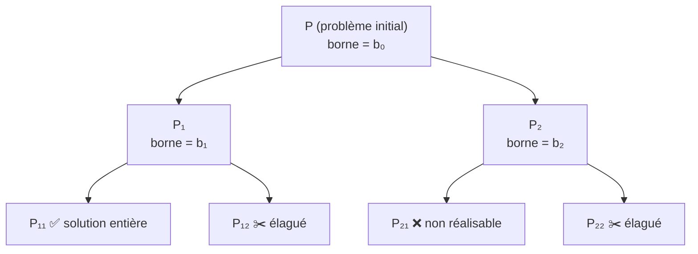
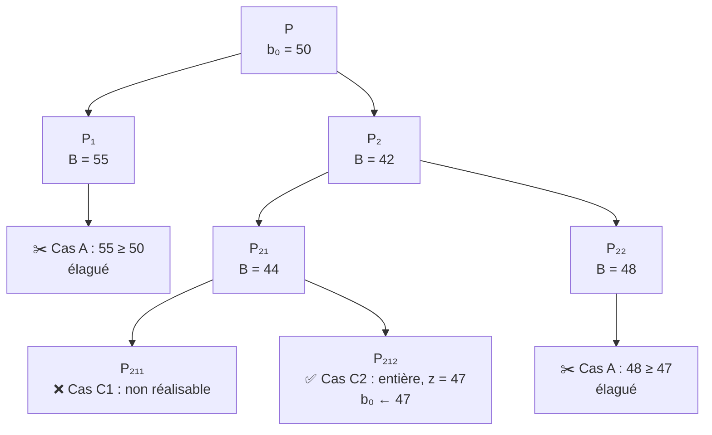

### Idée générale du B&B

#### 🎯 Le problème

Un PLNE est **NP-complet** : énumérer toutes les solutions entières coûte exponentiellement cher.

> Avec $n$ variables binaires, il y a $2^n$ solutions. Pour $n=50$ : $\approx 10^{15}$ cas ❌

#### 💡 La solution : _Diviser pour régner_ + _bornes_

```
┌─────────────────────────────────────────────────────┐
│  B&B  =  SÉPARATION  +  ÉVALUATION                  │
│                                                     │
│  Séparation : découper le problème en sous-problèmes│
│  Évaluation : calculer une borne sur chaque morceau │
│               → couper (élaguer) ceux qui sont      │
│                 inutiles                            │
└─────────────────────────────────────────────────────┘
```

#### 🌳 L’arborescence




#### ✂️ Le principe de l’élagage

|Situation du nœud|Décision|
|---|---|
|Sa **meilleure valeur possible** (borne) est déjà **pire** que la meilleure solution connue|🪓 **On coupe** toute la branche|
|Sinon|🔀 **On sépare** en sous-nœuds|

👉 On ne visite **jamais** les sous-arbres qu’on sait inutiles → on évite d’explorer tout l’arbre.


## Les 4 ingrédients du B&B

### 🗺️ Vue d’ensemble

```
┌──────────────────────────────────────────────────────────────┐
│  1️⃣ Solution initiale   →  point de départ (borne b₀)        │
│  2️⃣ Branchement         →  découper P en sous-problèmes Pᵢ   │
│  3️⃣ Évaluation          →  calculer une borne B(Sᵢ)          │
│  4️⃣ Exploration         →  choisir l'ordre de visite         │
└──────────────────────────────────────────────────────────────┘
```

---

### 1️⃣ Solution initiale

|Point|Détail|
|---|---|
|**Rôle**|Donner une première valeur $b_0$ pour pouvoir **comparer** et **couper**|
|**Source**|Toute solution **réalisable** (souvent une heuristique)|
|**Qualité**|Meilleure $b_0$ ⟹ plus de coupes ⟹ moins de calcul|

> 💡 Même une mauvaise solution marche, mais B&B sera plus lent.

---

### 2️⃣ Branchement (séparation)

On décompose l’ensemble des solutions $S$ en sous-ensembles $S_1, \dots, S_k$.

**Deux conditions pour qu’il soit valide :**

|Condition|Écriture|Pourquoi|
|---|---|---|
|**Couverture**|$S = S_1 \cup S_2 \cup \dots \cup S_k$|Aucune solution perdue ⟹ l’optimum reste accessible|
|**Disjonction** (généralement)|$S_i \cap S_j = \emptyset$|Pas de travail en dou|
**Exemple (variable binaire $x_3$) :**

```
            S  (toutes les solutions)
           /  \
   x₃ = 0 /    \ x₃ = 1
         S₁     S₂

S₁ ∪ S₂ = S  ✅      S₁ ∩ S₂ = ∅  ✅
```

**Récursif** : on re-sépare chaque $S_i$ ⟹ on obtient l’**arbre de recherche**.

---

### 3️⃣ Évaluation (calcul de la borne)

On associe une borne $B(S_i)$ à chaque branche : c’est **la meilleure valeur possible** dans cette branche.

|Type de problème|Borne|Signification|
|---|---|---|
|**Minimisation**|borne **inférieure**|« Au mieux, on ne fera pas moins que $B$ »|
|**Maximisation**|borne **supérieure**|« Au mieux, on ne fera pas plus que $B$ »|

> 🔑 Cette borne est un **optimiste** : elle estime le **meilleur cas** de la branche.

---

### 4️⃣ Exploration (stratégie de parcours)

On fixe un **protocole** pour l’ordre de visite des nœuds :

|Stratégie|Principe|
|---|---|
|**En profondeur**|On descend jusqu’à une feuille avant de revenir|
|**En largeur**|On traite tous les nœuds d’un niveau avant de descendre|
|_(autres)_|ex. meilleure borne d’abord|

---

### 🧠 À retenir

$$\boxed{\text{B\&B} = b_0 \;+\; \text{Branchement (couverture)} \;+\; \text{Borne (meilleur cas)} \;+\; \text{Parcours}}$$

⚠️ **Remarque du cours** : B&B marche d’autant mieux que la **borne est bonne**.

## ✂️ Concept 3 : Règles d’élagage

*(On se place en **minimisation**. $b_0$ = meilleure valeur entière connue, au départ celle de la solution initiale.)*

###  Pour chaque nœud $S_i$, on calcule $B(S_i)$ puis on décide

|Cas|Condition|Décision|
|---|---|---|
|**A**|$B(S_i) \ge b_0$|✂️ **Élaguer** : au mieux on égale $b_0$, donc inutile|
|**B**|$B(S_i) < b_0$|🔀 **Séparer** puis explorer les fils|
|**C1**|Nœud **terminal** : $S_i$ non réalisable ($\emptyset$)|❌ **Rejeter**|
|**C2**|Nœud **terminal** : solution entière de valeur $b_1$|si $b_1 \ge b_0$ : rejeter ❌ ; si $b_1 < b_0$ : ✅ **nouvelle meilleure solution**, $b_0 \leftarrow b_1$|

> 🔑 Quand $b_0$ **diminue**, les coupes suivantes deviennent **plus nombreuses** : c’est pour cela qu’une bonne solution trouvée tôt accélère tout.

---

### 🌳 Exemple (minimisation, $b_0 = 50$ au départ)




