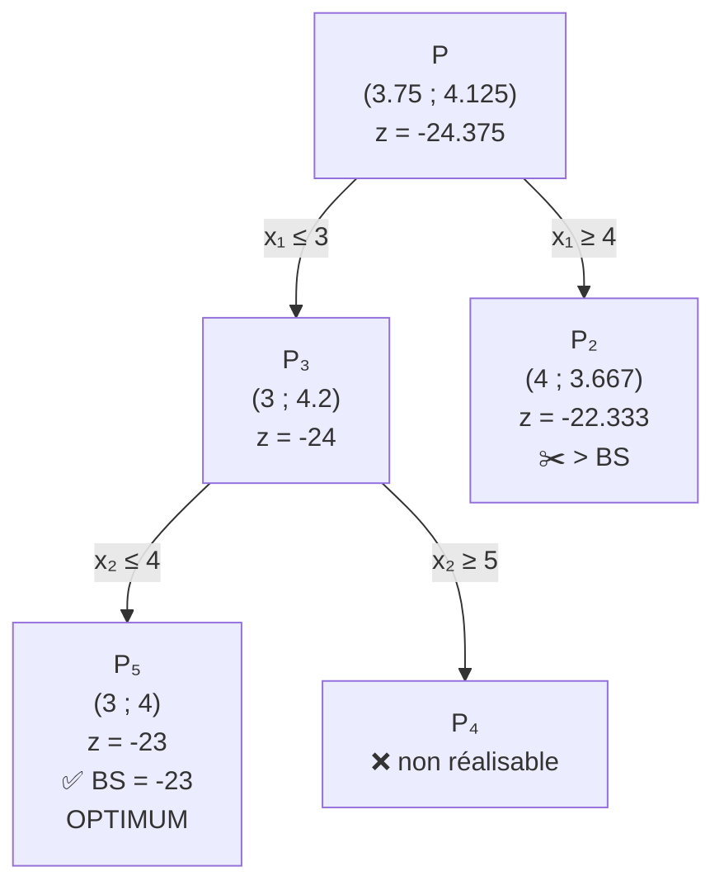

$$  
(P)\;\; \min z = -x_1 - 5x_2 \quad \text{s.c.} \quad  
\begin{cases} 11x_1 + 6x_2 \le 66 \\ x_1 + 10x_2 \le 45 \\ x_1, x_2 \ge 0,\ \text{entiers} \end{cases}  
$$

###  Recette du B&B en PLNE (répétée à chaque nœud)

```
1. Résoudre la relaxation (simplexe)
2. Tester :  infaisable ? → ❌   |  entière ? → ✅ (maj BS)  |  z ≥ BS ? → ✂️
3. Sinon : choisir une variable fractionnaire xₖ = v
           → deux fils :  xₖ ≤ ⌊v⌋   et   xₖ ≥ ⌈v⌉
```

> 💡 Le branchement **garde tous les points entiers** (couverture) et **élimine une tranche** fractionnaire.

---

###  Déroulement
![[Pasted image 20261012221405.png]]

![[Pasted image 20261012221551.png]]

| Nœud   | Contrainte ajoutée      | Solution de la relaxation | $z$       | Décision                                                               |
| ------ | ----------------------- | ------------------------- | --------- | ---------------------------------------------------------------------- |
| **P**  | aucune                  | $(3.75,\ 4.125)$          | $-24.375$ | fractionnaire ⟹  sur $x_1$ : $x_1 \le 3$ ($P_3$) / $x_1 \ge 4$ ($P_2$) |
| **P₃** | $x_1 \le 3$             | $(3,\ 4.2)$               | $-24$     | fractionnaire ⟹  sur $x_2$ : $x_2 \le 4$ ($P_5$) / $x_2 \ge 5$ ($P_4$) |
| **P₅** | $x_1 \le 3,\ x_2 \le 4$ | $(3,\ 4)$                 | $-23$     | ✅ **entière** ⟹ $BS = -23$                                             |
| **P₄** | $x_1 \le 3,\ x_2 \ge 5$ | —                         | —         | ❌ **non réalisable** ($F = \emptyset$)                                 |
| **P₂** | $x_1 \ge 4$             | $(4,\ 3.667)$ ()          | $-22.333$ | $-22.333 > BS = -23$ ⟹ ✂️ **élagué**                                   |


**Résultat :** $x^* = (3,\,4)$, $z^* = -23$.

---

###  L’arbre d’énumération





---

###  Points clés à comprendre

|Point|Explication|
|---|---|
|**Pourquoi $\lfloor 3.75 \rfloor = 3$ et $\lceil 3.75 \rceil = 4$ ?**|Aucun entier n’existe strictement entre 3 et 4 : on coupe la tranche $3 < x_1 < 4$ sans perdre de solution entière|
|**Pourquoi élaguer $P_2$ ?**|Sa meilleure valeur possible ($-22.333$) est **pire** que $BS = -23$ : ses fils ne pourront jamais descendre sous $-23$|
|**Rôle de $BS$**|Meilleure solution entière trouvée (la valeur de $z$ la plus basse, en min)|
|**Fin de l’algorithme**|Tous les nœuds sont traités (séparés, élagués, ou feuilles)|

> ⚠️ Le choix de **l’ordre** (ici $P_3$ avant $P_2$) ne change pas l’optimum, seulement le **nombre de nœuds** visités.

[^1]: nfnrnf
