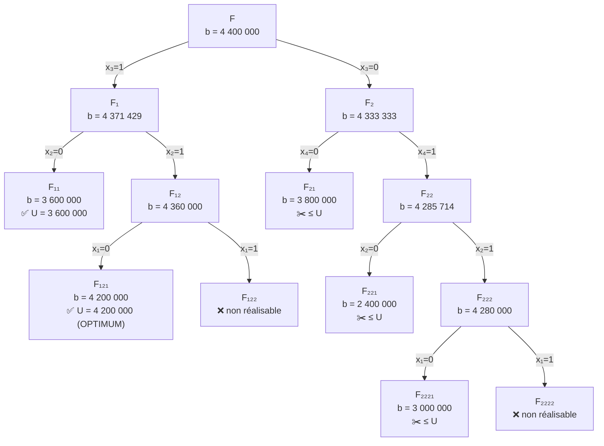

### Le problème

4 investissements, **budget (capacité) = 1 400 000** *(valeur déduite des calculs du cours : $500+700+0.5\times400$)*. Variables $x_i \in \{0,1\}$ : on prend l’investissement $i$ ou non. On **maximise** le bénéfice.

||Coût|Bénéfice|Rendement $=\frac{\text{bénéfice}}{\text{coût}}$|
|---|---|---|---|
|Inv. 1|500 000|1 600 000|**3.20**|
|Inv. 2|700 000|2 200 000|**3.14**|
|(0.5) Inv. 3|400 000|1 200 000|**3.00** (on le prend: non fractionaire)|
|Inv. 4|300 000|800 000|**2.67**|

---

### 💡 Deux simplifications (idée clé)

|#|Simplification|Conséquence|
|---|---|---|
|1|Variables **binaires**|Branchement simple : $x_k = 0$ / $x_k = 1$|
|2|Relaxation $0 \le x_i \le 1$ résolue par **algorithme glouton**|Pas besoin de simplexe !|

#### 🧮 Glouton = calcul de la borne $b(F)$

```
1. Fixer les x_i imposés par le branchement (0 ou 1)
2. Trier les articles libres par rendement décroissant
3. Remplir la capacité dans cet ordre
4. Le dernier article pris peut être FRACTIONNÉ → b(F) = bénéfice total
```

> En **maximisation**, $b(F)$ est une borne **supérieure**. $U$ = meilleure solution entière connue (départ : $U=-\infty$).  
> ✂️ **Élaguer** si $b(F) \le U$ ou si $F$ est non réalisable.

---

### 🚀 Déroulement (ordre du cours)

| Nœud      | Fixé            | Glouton ⟹ $x$                    | $b(F)$    | Décision                                   |
| --------- | --------------- | -------------------------------- | --------- | ------------------------------------------ |
| **F**     | rien            | $(1,\,1,\,\tfrac12,\,0)$         | 4 400 000 | $x_3$ fractionnaire ⟹ 🔀 $x_3=1$ / $x_3=0$ |
| **F1**    | $x_3=1$         | $(1,\,\tfrac57,\,1,\,0)$         | 4 371 429 | 🔀 sur $x_2$                               |
| **F11**   | $x_3=1,\,x_2=0$ | $(1,0,1,1)$                      | 3 600 000 | ✅ entière ⟹ $U = 3\,600\,000$              |
| **F12**   | $x_3=1,\,x_2=1$ | $(\tfrac35,1,1,0)$               | 4 360 000 | 🔀 sur $x_1$                               |
| **F121**  | $+\,x_1=0$      | $(0,1,1,1)$                      | 4 200 000 | ✅ entière ⟹ $U = 4\,200\,000$              |
| **F122**  | $+\,x_1=1$      | coût $1\,600\,000 > 1\,400\,000$ | —         | ❌ non réalisable                           |
| **F2**    | $x_3=0$         | $(1,1,0,\tfrac23)$               | 4 333 333 | $>U$ ⟹ 🔀 sur $x_4$                        |
| **F21**   | $x_3=0,\,x_4=0$ | $(1,1,0,0)$                      | 3 800 000 | $\le U$ ⟹ ✂️                               |
| **F22**   | $x_3=0,\,x_4=1$ | $(1,\tfrac67,0,1)$               | 4 285 714 | $>U$ ⟹ 🔀 sur $x_2$                        |
| **F221**  | $+\,x_2=0$      | $(1,0,0,1)$                      | 2 400 000 | $\le U$ ⟹ ✂️                               |
| **F222**  | $+\,x_2=1$      | $(\tfrac45,1,0,1)$               | 4 280 000 | $>U$ ⟹ 🔀 sur $x_1$                        |
| **F2221** | $+\,x_1=0$      | $(0,1,0,1)$                      | 3 000 000 | $\le U$ ⟹ ✂️                               |
| **F2222** | $+\,x_1=1$      | coût $1\,500\,000 > 1\,400\,000$ | —         | ❌ non réalisable                           |

#### 🏆 Résultat

$$x^* = (0,\,1,\,1,\,1), \qquad \text{bénéfice optimal} = 4\,200\,000$$

---

### 🌳 L’arbre





---

### 🔍 Points clés

| Point                                | Explication                                                                                                                                                            |
| ------------------------------------ | ---------------------------------------------------------------------------------------------------------------------------------------------------------------------- |
| **Pourquoi F₂ n’est pas élagué ?**   | $4\,333\,333 > U = 4\,200\,000$ : il pourrait encore contenir mieux                                                                                                    |
| **Pourquoi F₂₂₂ n’est pas élagué ?** | $4\,280\,000 > 4\,200\,000$ ⟹ on doit vérifier ses fils (qui s’avèrent inutiles)                                                                                       |
| **Gain**                             | Le cours compte **7 nœuds terminaux** traités (F₁₁, F₁₂₁, F₁₂₂, F₂₁, F₂₂₁, F₂₂₂₁, F₂₂₂₂) au lieu d’une énumération complète *(la slide écrit $2^4=64$, mais $2^4=16$)* |
| **Variable de branchement**          | toujours la variable **fractionnaire** de la relaxation                                                                                                                |