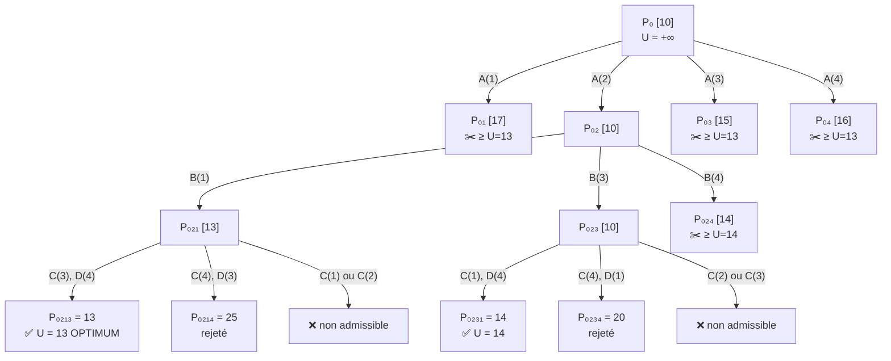

### Le problème

4 ouvriers (A, B, C, D), 4 tâches (1 à 4). Chaque ouvrier fait **une** tâche, chaque tâche est faite par **un** ouvrier. On **minimise** le temps total.

|Ouvrier|Tâche 1|Tâche 2|Tâche 3|Tâche 4|**Min de la ligne**|
|---|---|---|---|---|---|
|A|9|**2**|7|8|**2**|
|B|6|4|**3**|7|**3**|
|C|5|8|**1**|8|**1**|
|D|7|6|9|**4**|**4**|

---

### 1️⃣ Modélisation (d’où viennent les expressions)

$$  
x_{ij} = \begin{cases} 1 & \text{si l'ouvrier } i \text{ fait la tâche } j \\ 0 & \text{sinon} \end{cases}  
\qquad  
\min \sum_{i,j} c_{ij}\, x_{ij}  
$$

|Contrainte|Écriture|Sens|
|---|---|---|
|Chaque ouvrier : **1 tâche**|$\sum_j x_{ij} = 1\ \ \forall i$|somme sur **une ligne** $= 1$|
|Chaque tâche : **1 ouvrier**|$\sum_i x_{ij} = 1\ \ \forall j$|somme sur **une colonne** $= 1$|

> 💡 Une solution = **une permutation** : $4! = 24$ solutions possibles seulement, mais le B&B en évite la plupart.

---

### 2️⃣ Comment calculer la borne $b$ (⭐ l’équivalent du glouton du sac à dos)

$$\boxed{b(P) = \underbrace{\sum \text{coûts déjà décidés}}_{\text{ouvriers fixés}} \;+\; \underbrace{\sum_{\text{ouvriers restants}} \min_j c_{ij}}_{\text{meilleure tâche de chaque ligne}}}$$

On laisse chaque ouvrier restant prendre **sa tâche la plus rapide**, en **ignorant** les conflits entre eux. C’est donc **optimiste** ⟹ **borne inférieure** (minimisation).

#### 🧮 Borne racine $P_0$

$$b_0 = 2 + 3 + 1 + 4 = \mathbf{10} \quad \text{(somme des minima de lignes)}$$

#### 🧮 Bornes des fils $P_{0k}$ ($A$ fixé sur la tâche $k$)

On remplace le min de A par son **coût imposé**, on garde les minima de B, C, D $= 3+1+4 = 8$ :

|Fils|A fait|Coût de A|Calcul|$b$|
|---|---|---|---|---|
|$P_{01}$|tâche 1|9|$9 + 8$|**17**|
|$P_{02}$|tâche 2|2|$2 + 8$|**10**|
|$P_{03}$|tâche 3|7|$7 + 8$|**15**|
|$P_{04}$|tâche 4|8|$8 + 8$|**16**|

#### 🧮 Bornes des petits-fils $P_{02k}$ ($A(2)$ fixé, puis B fixé)

Reste C et D : $1 + 4 = 5$.

|Fils|B fait|Calcul|$b$|
|---|---|---|---|
|$P_{021}$|tâche 1 (coût 6)|$2 + 6 + 1 + 4$|**13**|
|$P_{023}$|tâche 3 (coût 3)|$2 + 3 + 1 + 4$|**10** _(la plus petite ⟹ la plus prometteuse)_|
|$P_{024}$|tâche 4 (coût 7)|$2 + 7 + 1 + 4$|**14**|

> ❓ **Pas de $P_{022}$** : la tâche 2 est déjà prise par A ⟹ B ne peut pas la faire.

---

### 3️⃣ Résolution des feuilles (quand il ne reste que C et D)

Il ne reste que **2 tâches libres** pour C et D ⟹ 2 possibilités seulement, on les calcule **exactement** :

**Branche $P_{023}$** ($A(2), B(3)$ ⟹ tâches libres : 1 et 4)

|Choix|Calcul|Total|
|---|---|---|
|C(1), D(4) $= P_{0231}$|$2+3+5+4$|**14** ✅|
|C(4), D(1) $= P_{0234}$|$2+3+8+7$|20|
|C(2), C(3) $= P_{0232}, P_{0233}$|tâches 2, 3 déjà prises|❌ non admissibles|

⟹ **$U = 14$**.

**Élagage** (borne $\ge U$) : $P_{01}[17],\ P_{03}[15],\ P_{04}[16],\ P_{024}[14]$ ($14 \ge 14$) ✂️. Reste $P_{021}[13]$ car $13 < 14$.

**Branche $P_{021}$** ($A(2), B(1)$ ⟹ tâches libres : 3 et 4)

|Choix|Calcul|Total|
|---|---|---|
|C(3), D(4) $= P_{0213}$|$2+6+1+4$|**13** ✅|
|C(4), D(3) $= P_{0214}$|$2+6+8+9$|25|
|C(1), C(2)|tâches 1, 2 déjà prises|❌|

⟹ **$U = 13$**, et $P_{023}$ (14) est élagué à son tour.

#### 🏆 Résultat

$$\text{A}\to 2,\ \text{B}\to 1,\ \text{C}\to 3,\ \text{D}\to 4 \quad\Rightarrow\quad 2 + 6 + 1 + 4 = \mathbf{13}$$

---

### 🌳 L’arbre

---

### 🧠 À retenir

| Idée                   | Détail                                                                                          |
| ---------------------- | ----------------------------------------------------------------------------------------------- |
| **Branchement**        | on fixe le prochain ouvrier sur **chaque tâche encore libre** (plusieurs fils, pas seulement 2) |
| **Borne**              | coûts fixés + **minimum de chaque ligne** des ouvriers restants                                 |
| **Exploration**        | on traite d’abord le nœud à **meilleure (plus petite) borne** ($P_{023}$)                       |
| **Élagage**            | $b \ge U$ ⟹ ✂️ ; non admissible ⟹ ❌ ; feuille ⟹ calcul exact et mise à jour de $U$              |
| **Mise à jour de $U$** | $U$ ne fait que **baisser** (14 puis 13), donc de plus en plus de coupes                        |